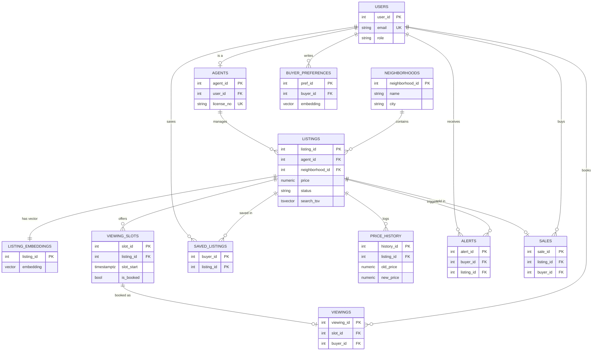

# ER Diagram and Relational Schema

Renders on GitHub (Mermaid is built in). To get a PNG for the report, paste the block into https://mermaid.live and export.



## Relational schema (compact)

```
users(user_id PK, full_name, email UNIQUE, password_hash, role CHECK, created_at)
agents(agent_id PK, user_id FK->users UNIQUE, license_no UNIQUE, agency_name, phone)
neighborhoods(neighborhood_id PK, name, city, UNIQUE(name, city))
listings(listing_id PK, agent_id FK->agents, neighborhood_id FK->neighborhoods, title, description,
         property_type CHECK, price CHECK>0, bedrooms CHECK>=0, bathrooms, area_sqft, status CHECK,
         created_at, search_tsv GENERATED)
listing_embeddings(listing_id PK/FK->listings, embedding vector(384), model_name, created_at)
buyer_preferences(pref_id PK, buyer_id FK->users, note_text, embedding vector(384), created_at)
viewing_slots(slot_id PK, listing_id FK->listings, slot_start, is_booked, UNIQUE(listing_id, slot_start))
viewings(viewing_id PK, slot_id FK->viewing_slots UNIQUE, buyer_id FK->users, status CHECK, created_at)
saved_listings(buyer_id FK, listing_id FK, PK(buyer_id, listing_id))
price_history(history_id PK, listing_id FK, old_price, new_price, changed_at)
alerts(alert_id PK, buyer_id FK, listing_id FK, message, is_read, created_at)
sales(sale_id PK, listing_id FK->listings UNIQUE, buyer_id FK->users, sale_price CHECK>0, sale_date)
```

## Normalization note
All tables are in 3NF: neighborhood data is separated from listings, agent data from users, the many-to-many
buyer/listing relation is resolved by `saved_listings`, and a booking is separated from the slot it consumes.
